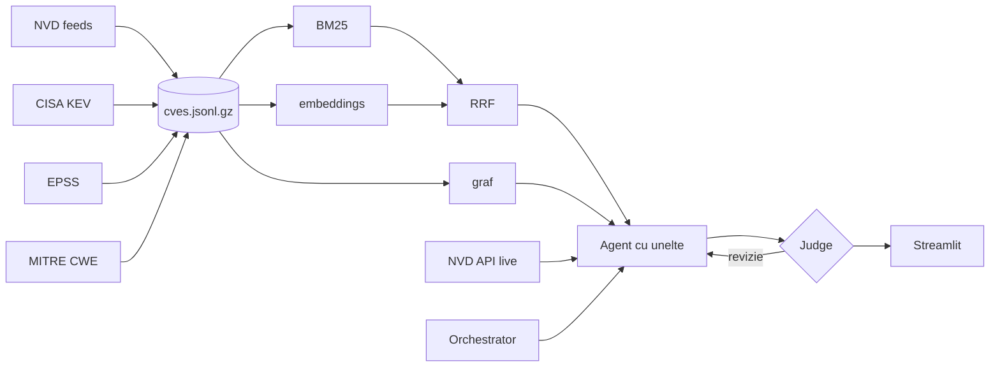

# 🛡️ CVEScope

**Asistent AI pentru triajul vulnerabilităților software.** Un dataset de 116.902 CVE-uri (NVD 2025–2026 + CISA KEV + EPSS + CWE), căutare hibridă (BM25 + semantică + RRF + graf), clasificare, sumarizare și agenți LLM cu verificarea ancorării.

> Proiect la disciplina *Ingineria algoritmilor pentru sisteme AI*, Master Inginerie Software, Facultatea de Matematică și Informatică, Universitatea din București, 2026–2027.

## Problema

În 2026 se publică peste 200 de CVE-uri pe zi. O echipă de securitate are trei întrebări:

1. **Ce mă privește?** Trebuie să caute după produs sau după tipul problemei, nu doar după ID.
2. **Ce înseamnă?** Descrierile sunt tehnice și eterogene.
3. **Ce repar întâi?** Doar ~0,3% din CVE-uri sunt exploatate activ (CISA KEV).

În plus, la publicare, multe CVE-uri **nu au încă CWE sau CVSS de la NVD** (backlog). Clasificarea lor automată din descriere are valoare practică.

## Ce face

| componentă (cerută în fișa disciplinei) | implementare | modul |
|---|---|---|
| **Dataset propriu: colectare** | feed-uri NVD 2.0 + CISA KEV + FIRST EPSS + MITRE CWE, parsate și unite; aproape-duplicate găsite cu MinHash/LSH | [`dataset.py`](cvescope/dataset.py) |
| **Dataset propriu: adnotare** | taxonomie de 12 clase; set gold de 144 de CVE-uri cu adnotare dublă (NVD vs. LLM), κ Cohen, arbitraj | [`annotate.py`](cvescope/annotate.py) |
| **Căutare** | BM25 implementat pe matrice sparse, embeddings, Reciprocal Rank Fusion, filtre, graf CVE–produs–CWE, agregate | [`search.py`](cvescope/search.py) |
| **Clasificare** | TF-IDF + SVM liniar vs. 3 LLM-uri cu ieșire structurată; separare pe grupuri, ca să nu existe scurgeri | [`classify.py`](cvescope/classify.py) |
| **Sumarizare** | rezumat structurat și ancorat al unui CVE, pentru un sysadmin | [`summarize.py`](cvescope/summarize.py) |
| **Date sintetice** | întrebări de căutare generate de LLM, validate (fără ID și fără text copiat) | [`synth.py`](cvescope/synth.py) |
| **Agenți** | agent ReAct cu 5 unelte, inclusiv extragere live din NVD API; Orchestrator → cercetători în paralel → Judge, cu self-refine | [`agent.py`](cvescope/agent.py), [`team.py`](cvescope/team.py) |
| **Evaluare** | Recall@k / MRR, acuratețe / macro-F1, LLM-as-a-judge + verificări deterministe, cost și latență | [`evaluate.py`](cvescope/evaluate.py) |
| Interfață | Streamlit: asistent, căutare, fișa unui CVE, clasificare | [`app.py`](app.py) |

## Rezultate pe scurt

| componentă | rezultat |
|---|---|
| Dataset | **116.902** CVE-uri · 93,6% etichetate · 364 în CISA KEV · 14,3% în clustere de aproape-duplicate |
| Adnotare | 144 CVE-uri, adnotare dublă, **κ Cohen = 0,818**; eticheta oficială NVD/CNA e corectă în **95,1%** din cazuri |
| Căutare (191 de întrebări sintetice) | MRR@10: BM25 0,802 · **dense 0,881** · hibrid 0,868 · Recall@10 = 0,979 |
| Clasificare `vuln_class` (12 clase) | baseline TF-IDF + SVM: macro-F1 **0,879** (split pe grupuri) · pe gold: baseline 0,885, `gpt-4.1-nano` 0,888, `gpt-4.1-mini` 0,857, **`gpt-5-mini` 0,936** |
| Severitate din descriere | macro-F1 0,553: greu doar din text |
| Sumarizare (15 CVE-uri KEV) | judge: grounded 4,87 / 5 · 100% pass · $0,001 per rezumat |
| Agenți (12 întrebări) | agent simplu: **10/12** pass, $0,002, 5 s · orchestrator + judge: **11/12**, $0,014, 56 s · **0** ID-uri inventate |
| Cost total al proiectului | ~$0,30 embeddings + **$0,76** pentru toate apelurile LLM |

Tabelele complete sunt în [docs/results.md](docs/results.md), iar interpretarea în [docs/evaluation.md](docs/evaluation.md).

## Pornire rapidă

```bash
git clone https://github.com/tonyc973/cvescope && cd cvescope
make setup                      # .venv + dependențe (cere uv; altfel: python -m venv .venv && pip install -r requirements.txt)
cp .env.example .env            # completează OPENAI_API_KEY (merge și cu OpenRouter: OPENAI_BASE_URL)
make test                       # teste offline, fără cheie
make index                      # embeddings pentru căutarea semantică (~$0,30, ~15 min)
make app                        # http://localhost:8501
```

Dataset-ul procesat (`data/cves.jsonl.gz`) e inclus în repo. `make data` îl reconstruiește din surse în aproximativ un minut.

Din linia de comandă:

```bash
.venv/bin/python -m cvescope.search "unauthenticated RCE in VPN gateway"
.venv/bin/python -m cvescope.agent "Ce vulnerabilități Ivanti sunt exploatate activ și pe care o repar prima?"
.venv/bin/python -m cvescope.team  "Compară vulnerabilitățile Citrix NetScaler și PAN-OS din KEV în 2026"
.venv/bin/python -m cvescope.summarize CVE-2026-21589
make eval                       # toate evaluările → docs/results.md
```

## Arhitectura



Detalii, formule și complexitate: [docs/methodology.md](docs/methodology.md).

## Documentație

| document | conținut |
|---|---|
| [dataset_card.md](docs/dataset_card.md) | fișa dataset-ului: surse, câmpuri, distribuții, preprocesare, limitări, licențe |
| [annotation_guidelines.md](docs/annotation_guidelines.md) | taxonomia, regulile de adnotare, acordul, ce am învățat din arbitraj |
| [methodology.md](docs/methodology.md) | fiecare pas: algoritm, decizie, compromis măsurat |
| [evaluation.md](docs/evaluation.md) | protocolul de evaluare și interpretarea rezultatelor |
| [results.md](docs/results.md) | tabelele generate automat |
| [related_work.md](docs/related_work.md) | studiul literaturii |
| [roadmap.md](docs/roadmap.md) | cele 3 prezentări, ce e gata, ce urmează, cine ce deține |
| [.claude/skills/cvescope/SKILL.md](.claude/skills/cvescope/SKILL.md) | skill pentru Claude Code: regulile și rețetele proiectului |

## Structura

```
cvescope/        codul (un modul per pas, vezi tabelul de mai sus)
app.py           interfața Streamlit
data/            cves.jsonl.gz, gold/, synth/, eval_questions.jsonl, results.json
docs/            documentația
tests/           teste offline (LLM fals, fără rețea)
```

## Date și atribuire

This product uses data from the NVD API but is not endorsed or certified by the NVD. CISA KEV: CC0. EPSS: © FIRST (Jacobs et al., 2021). CWE™: © MITRE. Detalii în [fișa dataset-ului](docs/dataset_card.md#7-licențe-și-atribuire). Codul e publicat sub licența MIT.
