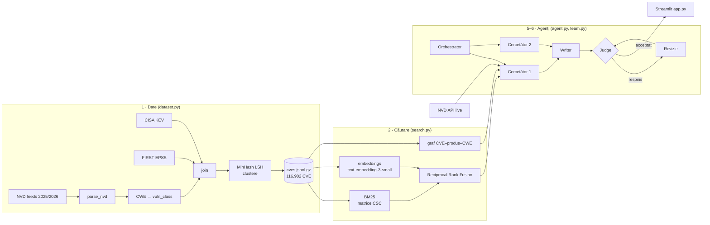

# Metodologie și arhitectură

Fiecare secțiune corespunde unui modul din `cvescope/` și unui capitol din fișa disciplinei.



## 1. Colectarea datelor (`dataset.py`)

Detaliile sunt în [dataset_card.md](dataset_card.md). Câteva decizii de inginerie:

- **Un singur parser** (`parse_nvd`) pentru feed-uri și pentru API-ul live. Agentul și dataset-ul văd astfel aceeași structură. E testat în `tests/test_core.py::test_parse_nvd`.
- **MinHash + LSH** pentru aproape-duplicate, după Broder (1997) și Leskovec et al., *Mining of Massive Datasets*, cap. 3:
  - **Ideea:** compararea fiecărei perechi ar însemna 117k² / 2 ≈ 6,8 miliarde de comparații. În loc de asta, fiecare document primește o **semnătură** de 128 de numere. Fiecare număr e minimul unei funcții hash aplicate pe 3-gramele de cuvinte. Proprietatea-cheie: *probabilitatea ca două semnături să coincidă pe o poziție este exact similaritatea Jaccard a documentelor*.
  - **LSH (benzi):** semnătura se taie în 16 benzi de 8 numere. Documentele care au o bandă identică ajung în aceeași „găleată”, așa că doar ele sunt comparate. Pragul efectiv e ≈ (1/16)^(1/8) ≈ 0,71, apoi verificăm Jaccard ≥ 0,8 pe semnături.
  - **Union-find** unește perechile în clustere.
  - **Cost:** O(n · 128 · |shingles|) pentru semnături și O(n · benzi) pentru LSH. Măsurat pe 117k documente: 19 s semnăturile, plus 4 s LSH și union-find.
  - `shortcut:` fiecare document e comparat doar cu primul membru al găleții. Se pot pierde câteva perechi tranzitive, ceea ce e acceptabil pentru separarea train/test.
- **Hashing:** `zlib.crc32` pentru shingle-uri, deterministic. `hash()` din Python e randomizat la fiecare rulare.

## 2. Căutare (`search.py`)

### BM25, implementat de noi

Formula Okapi BM25 (Robertson & Zaragoza, 2009), cu k1 = 1,5 și b = 0,75:

```
score(d, q) = Σ_{t ∈ q} idf(t) · f(t,d)·(k1+1) / (f(t,d) + k1·(1 − b + b·|d|/avgdl))
idf(t) = ln(1 + (N − df(t) + 0,5) / (df(t) + 0,5))
```

Matricea termen–document e stocată **CSC** (pe coloane). Coloana `t` conține exact lista documentelor care conțin termenul `t`, deci matricea CSC **este un index inversat**. Interogarea atinge doar documentele care conțin termenii ei: O(Σ df(t)), nu O(N · |q|).

Am renunțat la biblioteca `rank-bm25`. Aceasta parcurge toate cele N documente în Python pentru fiecare termen al interogării, adică O(N · |q|) operații Python. Versiunea noastră atinge doar listele de postări și e vectorizată: **< 1 ms** per interogare pe 117k documente (măsurat). Bonus: algoritmul e vizibil în cod, ceea ce e util la o materie de inginerie a algoritmilor.

### Căutare semantică (dense)

- `text-embedding-3-small` cu `dimensions=512`. Embedding-urile OpenAI sunt de tip Matryoshka, deci pot fi trunchiate cu pierderi mici. Rezultă o matrice float32 de 117k × 512, adică 240 MB, iar căutarea e un produs matrice-vector, `emb @ q`.
- Selecția top-k folosește `np.argpartition`, care e O(n), și sortează doar cele k elemente rămase.

**Decizie măsurată: local vs. API.** Am măsurat embedding-urile locale pe mașina de dezvoltare (2 nuclee, partajată):

| model | viteză | timp pentru 117k | cost |
|---|---|---|---|
| `BAAI/bge-small-en-v1.5` (ONNX cuantizat, fastembed) | 9 doc/s | ~3,6 h | 0 |
| `all-MiniLM-L6-v2` (ONNX, fastembed) | 26 doc/s | ~75 min | 0 |
| `text-embedding-3-small` (API) | ~8.000 doc/min (plafon de rată 1M TPM) | 15 min (măsurat) | ~$0,30 |

Am ales API-ul. Pe un GPU sau pe un CPU mai puternic, modelul local devine competitiv și elimină dependența de rețea. Asta e o direcție pentru roadmap.

### Reciprocal Rank Fusion (Cormack, Clarke & Büttcher, SIGIR 2009)

`score(d) = Σ_rankings 1 / (60 + rank(d))`. Folosește doar **pozițiile** documentelor, nu scorurile. Scorurile BM25 (0–30) și cele cosinus (0–1) nu sunt comparabile, iar RRF ocolește complet problema normalizării. Fiecare metodă propune top 50, iar RRF le combină.

### Filtre

`severity`, `vuln_class`, `kev_only`, `vendor` și `since` devin o **mască booleană** aplicată înainte de top-k. Rezultatul are exact k rezultate filtrate, nu „top-k, apoi filtrare”, care ar putea întoarce 0.

### Graf (GraphRAG hibrid, varianta simplă)

Graful e bipartit: nodurile CVE sunt legate de nodurile **produs** și **CWE**.

- **`related(cve)`**: drum de lungime 2, CVE → {produse, CWE} → alte CVE-uri. Un produs comun valorează 2, un CWE comun valorează 1, iar egalitățile se rup după EPSS. Răspunde la întrebări de tipul *„ce altceva mai e vulnerabil la același vendor?”*.
- **`stats(filtre)`**: agregate peste **toate** CVE-urile care trec de filtre.

Aceasta e lecția din GraphRAG (Edge et al., 2024): întrebările **globale** („câte…”, „care sunt cele mai frecvente…”) nu au răspuns într-un top-k de documente. Au nevoie de agregare peste întreaga colecție. Agentul alege între căutare (întrebări locale) și `stats` (întrebări globale).

## 3. Adnotare (`annotate.py`)

Detaliile sunt în [annotation_guidelines.md](annotation_guidelines.md): adnotare dublă (NVD vs. LLM), κ Cohen și arbitraj.

## 4. Clasificare (`classify.py`)

- **Baseline:** TF-IDF pe unigrame și bigrame, cu `sublinear_tf`, urmat de un **SVM liniar**. Antrenarea pe ~87k descrieri durează în jur de un minut pe CPU și nu costă nimic.
- **LLM zero-shot:** cu **ieșire structurată**. API-ul e constrâns la schema JSON a unei clase pydantic, iar pydantic o **re-validează** local. `rationale` e generat *înaintea* etichetei, ca un mic lanț de raționament.
- **Separare pe grupuri** (`GroupShuffleSplit` pe `cluster`): toate aproape-duplicatele unui șablon ajung de aceeași parte. Cu o separare aleatoare, modelul poate „recunoaște” la test un șablon văzut la antrenare și scorul poate fi umflat. Aceasta e *data leakage* (Kapoor & Narayanan, 2023). Raportăm ambele variante ca să **măsurăm** efectul. Aici s-a dovedit mic (vezi [evaluation.md](evaluation.md#2-clasificare)), dar separarea pe grupuri rămâne regula.
- **Ținte:** `vuln_class` (12 clase) și severitatea CVSS (4 clase). Metrica principală e **macro-F1**, pentru că clasele sunt dezechilibrate.

## 5. Agent cu unelte (`agent.py`)

Bucla ReAct (Yao et al., 2023) prin *function calling*:

```
mesaje = [system, user]
repetă de maximum 8 ori:
    răspuns = LLM(mesaje, unelte)
    dacă nu cere unelte: STOP
    pentru fiecare apel: rezultat = unealta(argumente)   # erorile se întorc la model, ca să se corecteze
    mesaje += rezultatele
```

| unealtă | ce face | tipul întrebării |
|---|---|---|
| `search_cves` | căutare hibridă + filtre | locală, tematică |
| `get_cve` | înregistrarea completă; pentru alți ani o **extrage live** din NVD API + FIRST EPSS API | căutare după ID |
| `related_cves` | parcurgere în graf | „înrudite” |
| `cve_stats` | agregate | globală |
| `prioritize` | ordine **deterministă**: KEV > EPSS > CVSS | „ce repar întâi” |

**Ieșirea uneltelor ghidează modelul.** `search_cves` întoarce top-k, dar raportează și câte CVE-uri trec de filtre în total. Când lista e trunchiată, adaugă `"note": "... call cve_stats ..."`. Această linie a reparat întrebările de tip „listează toate” (de la 8/14 la 14/14, vezi [evaluation.md](evaluation.md#istoria-iterațiilor-ce-a-prins-evaluarea)). O eroare a unei unelte (de exemplu un argument lipsă) se întoarce la model ca text, iar modelul își corectează apelul.

**Verificarea ancorării (grounding), deterministă:** orice ID de CVE din răspuns trebuie să apară în rezultatele uneltelor sau în întrebare. Altfel e marcat `ungrounded`, adică probabil inventat. E o verificare de cost zero, care nu depinde de un alt LLM.

**Securitate:** `get_cve` validează ID-ul cu o expresie regulată *înainte* de a-l pune într-un URL, pentru că textul produs de model nu e de încredere. Uneltele sunt read-only.

## 6. Sistem multi-agent (`team.py`)

1. **Orchestrator** (ieșire structurată `Plan`): împarte întrebarea în 1–3 sub-întrebări independente.
2. **Cercetători**: câte un `agent.run` per sub-întrebare, **în paralel** (`ThreadPoolExecutor`).
3. **Writer**: combină notițele cercetătorilor. Pasul e sărit când există o singură sub-întrebare.
4. **Judge**: alt model (`gpt-5-mini`, altă familie decât generatorul, ca să limităm preferința pentru propriul stil, Zheng et al., 2023). Primește dovezile, adică rezultatele uneltelor, și notează 1–5 pe trei criterii: *grounded*, *complete*, *useful*.
5. **Criteriul de oprire:** toate scorurile ≥ 4 **și** niciun ID neancorat, **sau** 3 runde consumate. Altfel cercetătorul primește feedback-ul și reface răspunsul (Self-Refine, Madaan et al., 2023).
6. **Trace:** fiecare pas (rol, timp, unelte, scoruri) e înregistrat și afișat în interfață.

**Ce e un „agent” aici:** termenul e folosit doar pentru componentele în care un LLM **decide** pași (Orchestrator, Cercetător, Judge). Writer-ul e un singur apel LLM, iar `prioritize` e o funcție deterministă, deci nu le numim agenți.

## 7. Date sintetice (`synth.py`)

Generăm 200 de întrebări realiste („cum ar căuta un sysadmin”). Fiecare are ca răspuns un CVE cunoscut, ales doar dintre CVE-urile **fără aproape-duplicate**, ca ținta să fie unică. Validarea elimină întrebările care:

- conțin ID-ul CVE-ului;
- copiază cel puțin 6 cuvinte consecutive din descriere, ceea ce ar favoriza artificial BM25. Verificarea e un string matching pe n-grame.

## 8. LLM: cache, cost, furnizori (`llm.py`)

- **Memoizare** (programare dinamică aplicată apelurilor scumpe): cheia e `sha256(model + mesaje + unelte/schemă)`, iar valoarea e stocată în SQLite. O cerere identică e plătită o singură dată. Costul și latența se salvează **împreună cu răspunsul**, deci o evaluare rerulată din cache raportează aceleași cifre, gratuit și reproductibil.
- **Furnizori:** clientul `openai` citește `OPENAI_BASE_URL`, deci același cod merge cu OpenAI, OpenRouter sau Ollama local.
- **Costuri:** prețurile sunt în `PRICES` (USD per 1M tokeni). Bara laterală din aplicație arată costul sesiunii.

## Complexitate (n = 116.902 documente, d = 512; timpi măsurați pe un CPU cu 2 nuclee, partajat)

| operație | timp | memorie |
|---|---|---|
| construire index (BM25 + graf + măști) | O(total tokeni) — **7,7 s** | CSC: 4,6M valori nenule, vocabular 224k |
| interogare BM25 | O(Σ df(t)) — **< 1 ms** | O(n) scoruri |
| interogare dense | O(n·d) ≈ 60M operații — **~20 ms** | 240 MB |
| interogare hibridă (cu embedding-ul interogării din cache) | **~30 ms** | |
| RRF | O(k log k) | O(k) |
| `related` | O(Σ grad(nod)) | O(n) |
| MinHash + LSH | O(n · 128 · shingles) — **23 s** | O(n · 128) |
